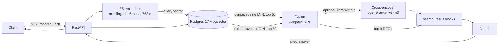
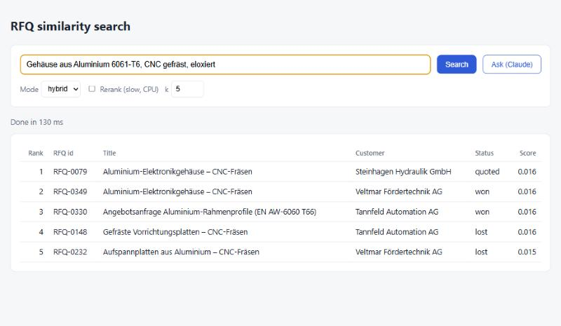

# RAG RFQ Search

Find the most similar past industrial RFQs (requests for quotation) for a new one, see which customers requested them, and get a short Claude summary that cites those past RFQs.

It is a small, hand-written RAG service: Postgres + pgvector for storage and vector search, a local multilingual embedding model, Postgres full-text search as a second retriever, and Claude with native citations for the answer. Retrieval quality is measured on a labelled query set, and this README reports what the measurements actually showed, including a result that went against the original plan.

> **All data in this repository is fully synthetic.** The RFQs, customers, part families and quantities are generated by a seeded script (`scripts/generate_data.py`) from templates, in English, German and Turkish. No real company, customer or price appears anywhere.

## Architecture



Each RFQ is chunked, embedded with `intfloat/multilingual-e5-base` (`passage:` prefix) and stored with a generated `tsvector` column. A query goes through dense search (cosine kNN over an HNSW index, see below) and lexical search (`websearch_to_tsquery`, `ts_rank_cd`, with an OR-token fallback when the AND query matches nothing), then weighted Reciprocal Rank Fusion, then collapse to one hit per RFQ. Dense retrieval uses an HNSW index (`vector_cosine_ops`). `hnsw.ef_search` is raised to the candidate count, and sequential scans are disabled for that one query, because pgvector's cost estimate otherwise makes the planner drop the index at the shipped depth (see the scale test). On the 400-RFQ eval corpus the indexed results are identical to exact kNN for all 140 eval queries, so the evaluation numbers below describe the shipped code. With `rerank: true`, the top 50 RFQs of the chosen mode are re-scored by a local multilingual cross-encoder (`BAAI/bge-reranker-v2-m3`) on their best chunk text. For `/ask`, the hits become Anthropic `search_result` content blocks, and Claude's answer comes back with citations that point at specific RFQs.

## Quickstart

Requires Docker (and, for `/ask`, an Anthropic API key).

```bash
cp .env.example .env          # optional: add ANTHROPIC_API_KEY for /ask; API_PORT defaults to 8000
docker compose up -d --build
docker compose run --rm api python -m app.ingest
```

The first ingest downloads the embedding model (about 1.1 GB, cached in the `hf_cache` volume). Ingest truncates and re-embeds all 400 RFQs, so it can be re-run at any time.

Check it and search (use your `API_PORT`, default 8000):

```bash
curl -s localhost:8000/health

curl -s -X POST localhost:8000/search \
  -H "Content-Type: application/json" \
  -d '{"query": "CNC-milled aluminium 6061 manifold block, 5-axis, tight tolerances", "k": 5, "mode": "hybrid"}'

curl -s -X POST localhost:8000/ask \
  -H "Content-Type: application/json" \
  -d '{"query": "CNC-milled aluminium 6061 manifold block, 5-axis, tight tolerances", "k": 5}'
```

`mode` is `dense`, `lexical` or `hybrid` (default `hybrid`). `"rerank": true` reranks the top 50 with the cross-encoder; it is opt-in because it takes about 23 s per query on a laptop CPU (the model is downloaded on first use into `hf_cache`). `/ask` needs `ANTHROPIC_API_KEY` in `.env`; without it `/ask` returns HTTP 503 and `/search` keeps working. The model is set with `CLAUDE_MODEL` (default `claude-opus-5-5`).

**Search page:** open `http://localhost:8000/` (your `API_PORT`) for a minimal static page served by the API. It has a query box, the mode selector, an opt-in rerank checkbox and `k`. Results show the RFQ id, title, customer, status and score. Without a key, the Ask button shows "API key not configured".



**Windows Git Bash note:** non-ASCII JSON (German umlauts, Turkish characters) passed inline to `curl` can be mangled by the shell's code page. Put the JSON in a UTF-8 file and send it as bytes:

```bash
curl -s -X POST localhost:8000/search \
  -H "Content-Type: application/json; charset=utf-8" \
  --data-binary @query.json
```

where `query.json` contains, for example, `{"query": "Frästeil aus Aluminium 6061, 5-Achs, Toleranz 0,05 mm", "k": 3}`.

Configuration (environment variables, read by pydantic-settings): `DATABASE_URL`, `EMBEDDING_MODEL`, `CLAUDE_MODEL`, `ANTHROPIC_API_KEY`, `HYBRID_LEXICAL_WEIGHT` (default 0.0, see the evaluation), `RRF_K` (default 60), `RERANKER_MODEL` (default `BAAI/bge-reranker-v2-m3`; empty disables reranking, and `rerank: true` then returns HTTP 503), `RERANK_DEPTH` (default 50, 1 to 50).

Tests: `docker compose run --rm api pytest -q` (includes the integration tests against the `db` container), or `uv run pytest -q` on the host with the database up. No test needs an API key or network access to Anthropic.

Ingest timing: with the model already cached, loading it and embedding the 400 RFQs (400 chunks) takes **81.4 s** (CPU only, inside Docker on a laptop). The first run additionally downloads the model.

## Data

400 synthetic RFQs (240 English, 100 German, 60 Turkish) generated from 40 part families with seed 42: fictional customers with industry and country, materials, processes, quantities and status. Each RFQ carries a hidden `family_id` that is used only by the eval to define relevance; retrieval and Claude never see it. There are 80 eval queries (two per family); a query is relevant to the RFQs of its family, giving a mean of 10 relevant RFQs per query. 45 of the 80 queries are cross-language (the query's language differs from the family's main language) and most are written with a separate, buyer-style paraphrase vocabulary rather than the corpus wording.

**Chunking** is implemented (title and key-fields header repeated in every chunk, paragraph and sentence splitting under a word budget) and unit-tested, but in this corpus every RFQ fits in a single chunk: 400 RFQs produce 400 chunks. The multi-chunk path is therefore not exercised by the retrieval eval; the scale test below adds long notes so that 1,989 of 13,200 RFQs split into two chunks.

## Retrieval evaluation

Numbers come from `eval/results/retrieval.md` and `eval/results/hybrid_tuning.md`, produced by `scripts/eval_retrieval.py` and `scripts/tune_hybrid.py` on the real stack (Postgres, E5 embeddings).

Metrics, averaged over queries (mean relevant RFQs per query is 10):

- **hit@5**: fraction of queries with at least one relevant RFQ in the top 5.
- **P@5**: precision at 5, relevant RFQs in the top 5 divided by 5.
- **R@10**: recall at 10, relevant RFQs in the top 10 divided by all relevant RFQs.
- **MRR@20**: mean reciprocal rank of the first relevant RFQ within the top 20 (0 if none).

Overall (n = 80):

| mode | hit@5 | P@5 | R@10 | MRR@20 |
|---|---|---|---|---|
| dense | 0.725 | 0.358 | 0.255 | 0.638 |
| lexical | 0.487 | 0.185 | 0.148 | 0.361 |
| hybrid (shipped default, equals dense) | 0.725 | 0.358 | 0.255 | 0.638 |

Same-language (n = 35) versus cross-language (n = 45), MRR@20 / hit@5:

| mode | same-language | cross-language |
|---|---|---|
| dense | 0.737 / 0.829 | 0.561 / 0.644 |
| lexical | 0.505 / 0.686 | 0.248 / 0.333 |
| hybrid (shipped default, equals dense) | 0.737 / 0.829 | 0.561 / 0.644 |

Dev and test split by part family (20 families, 40 queries each; test is held out):

| system | dev MRR@20 | test hit@5 | test P@5 | test R@10 | test MRR@20 |
|---|---|---|---|---|---|
| dense | 0.587 | 0.725 | 0.385 | 0.246 | 0.689 |
| lexical | 0.343 | 0.475 | 0.195 | 0.150 | 0.379 |
| hybrid, equal weights (w_lex = 1.0, k = 60) | 0.532 | 0.675 | 0.270 | 0.213 | 0.546 |
| hybrid, selected (w_lex = 0.0, k = 60) | 0.587 | 0.725 | 0.385 | 0.246 | 0.689 |

Mean query latency per mode (ms, same machine): dense 54.7, lexical 6.5, hybrid 53.8.

### What this says

- **Dense (multilingual-e5-base) is the best retriever on this data.**
- **Plain RRF hybrid with equal weights hurt**: test MRR@20 0.546 versus 0.689 for dense alone.
- A **weighted-RRF sweep** (protocol fixed before the tuning run: lexical weight 0.0 to 1.0 and k in {10, 60}, selection by dev MRR@20 only, test reported whatever it showed) chose **lexical weight 0.0** on the dev split. So the shipped default `hybrid` equals dense. Lexical and hybrid remain available as modes, and the lexical weight is configurable via `HYBRID_LEXICAL_WEIGHT`.
- **Eval integrity:** the split and grid were defined after a first full-set run had shown equal-weight hybrid underperforming. Test families were held out from the selection step, not from all observation. The only tuning on these queries is that one sweep, selected on the dev split.
- Likely reasons (hypotheses consistent with the split numbers, not separately tested): 45 of 80 queries are cross-language and paraphrased, the `simple` full-text config does no stemming, and lexical retrieval is weak across languages (cross-language lexical MRR@20 0.248 versus 0.505 same-language, while dense holds 0.561 versus 0.737).
- On queries built around exact material and standard codes the picture reverses (see below): lexical retrieval is much better there, so the `w_lex = 0` default is a trade-off, not a universal win.

**Caveat:** the data is synthetic and template-generated. Templated text is easier than real RFQs, so the absolute numbers are optimistic. The point of the eval is the comparison between modes, not the absolute level.

### Reranking

A local cross-encoder (`BAAI/bge-reranker-v2-m3`, CPU) reranks the first-stage top candidates. Protocol fixed before the run: same 80 queries and family split, first stage = the shipped default, depth chosen from {20, 30, 50} by dev MRR@20 only, test reported whatever it showed. Depth 50 was selected. Results: `eval/results/rerank.md`.

| system | dev MRR@20 | test hit@5 | test P@5 | test R@10 | test MRR@20 |
|---|---|---|---|---|---|
| shipped default (first stage) | 0.587 | 0.725 | 0.385 | 0.246 | 0.689 |
| + rerank, depth 50 (selected) | 0.706 | 0.775 | 0.490 | 0.337 | 0.706 |

On the held-out test half, rerank raises P@5 from 0.385 to 0.490 and R@10 from 0.246 to 0.337, while MRR@20 moves only from 0.689 to 0.706. On the full set (80 queries, includes the dev half) MRR@20 goes from 0.638 to 0.706. The cost is latency: the reranker call takes 22.7 s mean (p95 26.3 s) per query at depth 50 and 10.6 s at depth 20 on a laptop CPU, against 69 ms for the first stage. That is why rerank is opt-in (`rerank: true`), a decision fixed before the run.

### Exact-code queries

The family eval cannot say whether lexical retrieval helps on exact codes, so a separate set of 60 queries was generated (seed 23) from codes that appear in the corpus: material grades such as `1.4408` or `42CrMo4` and standards such as `ISO 4401`. There are 20 single-code queries, 20 code pairs, and 20 pairs inside a short request sentence (8 English, 6 German, 6 Turkish). A query is relevant to every RFQ whose text contains all its codes as exact tokens. Nothing is tuned on this set. Results: `eval/results/code_queries.md`.

MRR@20:

| system | all (60) | single | pair | sentence |
|---|---|---|---|---|
| dense = shipped default | 0.498 | 0.585 | 0.509 | 0.399 |
| lexical | 0.815 | 1.000 | 1.000 | 0.446 |
| hybrid, equal weights | 0.807 | 1.000 | 1.000 | 0.422 |
| shipped default + rerank (depth 50) | 0.946 | 1.000 | 1.000 | 0.838 |

- **Lexical wins clearly on bare codes** (MRR@20 1.000 versus 0.585 for dense on single codes). The shipped default (`w_lex = 0`, chosen on the paraphrased family eval) is the weakest system here. The two eval sets pull the lexical weight in opposite directions; the default was **not** changed after seeing this, and users who search by code should use `mode: lexical` or `hybrid` with `HYBRID_LEXICAL_WEIGHT=1.0`.
- **Rerank has the best MRR@20 overall** (0.946; lexical keeps the best P@5 and equal-weight hybrid the best R@10), mainly on codes inside sentences (0.838 versus at most 0.446), at about 23 s per query.

### Scale test

Protocol fixed before the run, in a separate database (`rag_scale`). The corpus is 33 batches of the seeded generator (13,200 RFQs; 15 % with long notes), giving 15,189 chunks. The protocol planned 20,000 RFQs, with a gate that stops if the estimated embedding time exceeds 60 minutes. The estimate for that size was 87.9 min, so the size was reduced to 13,200 by an explicit decision before loading. The re-estimate for 13,200 RFQs was 60.4 min, still marginally over the gate; the run went ahead by the same explicit decision. Results: `eval/results/scale.md`.

- **Ingest:** E5 embedding on CPU runs at 4.2 chunks/s. Embedding and insert took about 56.6 min; that figure is derived from log timestamps, not timed (the window also includes container start, corpus generation and model load), because the first index build failed (the default 64 MB `/dev/shm` of the Postgres container is too small for a parallel HNSW build; `docker-compose.yml` now sets `shm_size: 1gb`). The HNSW build (m 16, ef_construction 64) took 2.9 s.
- **Size:** database 162.3 MB; `chunks` table 151.4 MB in total, of which the HNSW index is 59.3 MB and the GIN index 7.3 MB.
- **HNSW versus exact kNN** (200 queries, recall@10 against exact search, SQL latency):

| ef_search | recall@10 | mean ms |
|---|---|---|
| 20 | 0.880 | 2.0 |
| 40 | 0.941 | 2.2 |
| 80 | 0.972 | 2.7 |
| 200 (index forced) | 0.999 | 3.3 |
| exact (sequential scan) | 1.000 | 43.0 |

- **Planner finding:** pgvector's cost estimate for the HNSW scan grows with `ef_search`. At the default planner settings, `ef_search` 200 and 400 get a sequential scan plus sort instead of the index. The shipped `/search` path uses depth 50, which sets `ef_search` 200, so at this size it ran exact search (about 40 ms, recall 1.0) rather than HNSW. The smaller `dense_candidates(depth=10)` path did use the index: RFQ-level recall@10 0.939 at 3.4 ms.
- **Planner fix** (protocol fixed before the run; results in `eval/results/hnsw_fix.md`): `dense_candidates` now sets `enable_seqscan = off` for its one query, inside the transaction that is rolled back anyway. Two acceptance checks, both passed:
  - On the 400-RFQ corpus, the depth-50 dense ranking is identical to exact kNN for 140 of 140 queries (80 family and 60 exact-code), so the earlier evaluation numbers still hold.
  - At 13,200 RFQs, on 200 fresh queries (seed 29), the depth-50 path now uses the HNSW index. RFQ-level recall@50 is 0.993 and recall@10 0.996 against exact search, at 6.2 ms mean SQL time versus 45.0 ms before (pass criterion: recall@50 of at least 0.98).

### Answer quality

`/ask` uses Claude with `search_result` content blocks, so citations are produced by the API and point at retrieved RFQs (cited ids are checked against the retrieved set). An answer-quality eval script exists (`scripts/eval_answers.py`) but has **not been run yet: answer quality is not yet measured**, and there are no numbers for it.

## Design decisions

- **No framework.** Retrieval, fusion, chunking and answer assembly are plain Python, psycopg and SQL. Every step is visible and testable, which matters more here than the integrations a framework would add.
- **Why RRF.** Cosine distances and `ts_rank_cd` scores are on incomparable scales; RRF uses only ranks, so it needs no score calibration. The measurements then showed the lexical list should get weight 0 on this data, which is why the fusion is weighted and the weight is a setting rather than a constant.
- **Why the `simple` full-text config.** The corpus mixes English, German and Turkish, and no single stemmer fits all three. `simple` lowercases and tokenizes without stemming: predictable, but weak on inflected forms. A known trade-off (see future work).
- **Injected dependencies.** The FastAPI app factory takes the connection factory, the embedder and the Claude client as arguments. Tests pass fakes, so the suite runs without an API key and without Anthropic network access.
- **Native citations.** Passing retrieved RFQs as `search_result` blocks makes the API return citations tied to specific results, instead of asking the model to write citations in prose and parsing them. Citations that do not map to a retrieved RFQ are dropped.
- **Chunk header repetition.** Every chunk repeats the title and key-fields line so it is self-describing when retrieved alone. Only relevant for long RFQs, which this corpus does not contain.

## Limitations and future work

- **Synthetic, templated data:** absolute metrics are optimistic; real RFQs are messier. Evaluating on real data is the main open item.
- **Answer quality not yet measured:** faithfulness and citation accuracy of `/ask` need to be run with `scripts/eval_answers.py`.
- **Rerank latency:** the cross-encoder adds about 23 s per query on CPU. A GPU, a smaller reranker or a lower depth (10.6 s at depth 20) would be needed to make it the default.
- **One default for two query styles:** paraphrased queries favour dense, exact-code queries favour lexical. Routing by query type (for example, detecting code-like tokens) was not built or measured.
- **Language-aware full-text search:** per-language configs, plus `unaccent` for Turkish and German characters, might make lexical retrieval stronger on sentence-style queries; not measured.
- **Forced index scan:** disabling sequential scans for the dense query overrides the planner rather than fixing its cost model. If the index is missing (for example, during a bulk reload) Postgres still falls back to a sequential scan.
- **Scale test is retrieval-only:** no relevance labels exist for the 13k corpus, so it measures HNSW recall against exact search, not retrieval quality.
- Measurements are from a single CPU-only laptop; latency numbers are indicative only.

## Hygiene

`scripts/hygiene_scan.py` scans tracked files and the whole git history for API-key patterns and for any terms in the `RAG_DENYLIST` environment variable (comma-separated, supplied at run time and never stored in the repo). It exits 1 on any hit.

## License

MIT, see [LICENSE](LICENSE). Copyright (c) 2026 Erim Yararbaş.
